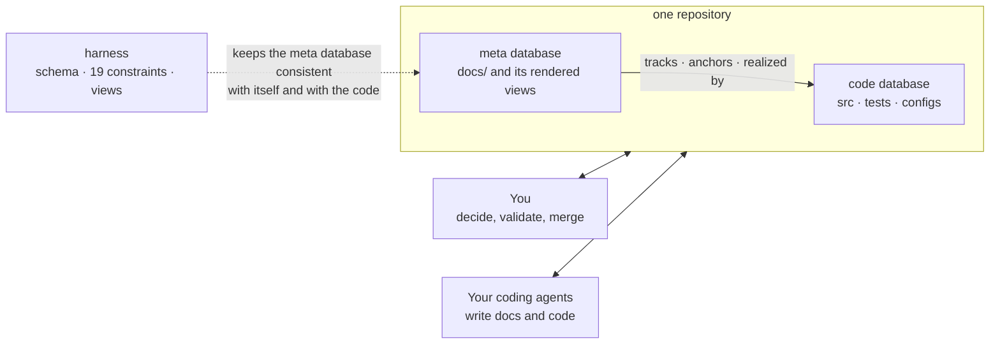
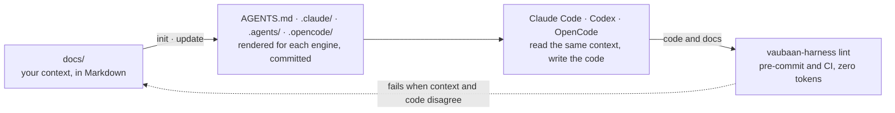
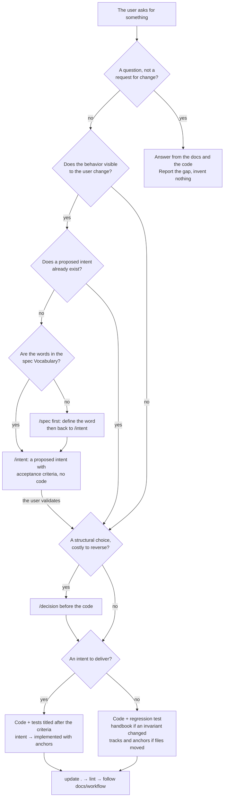

# @vaubaan/harness

<p align="center">
  <strong>Project context as code.</strong><br>
  A context database for your project, kept in the repo, rendered for your coding agents, linted in CI.
</p>

<p align="center">
  <a href="https://www.npmjs.com/package/@vaubaan/harness"></a>
  <a href="https://github.com/vaubaan/harness/actions/workflows/ci.yml"></a>
  <a href="./LICENSE"></a>
</p>

```bash
npx -y @vaubaan/harness init . --engines=claude-code
```

A few Markdown files hold what the code cannot say and point to the code and configs for everything else. The harness renders them into the native layout of Claude Code, Codex or OpenCode, and lints them so context and code never drift apart.

- **One context, every engine.** Nine skills, one per pillar plus an audit and a drift detector, each with a slash command. Written once for Claude Code, Codex and OpenCode.
- **Pointers that stay true.** Handbooks, test plans and intents declare the files they describe. When that code moves and the doc does not, the linter says so.
- **Checks with zero tokens.** Nineteen mechanical linters run in CI and in your pre-commit hook. No engine hook, no injected turn, no loop. The agent sees a failed command and fixes it.

**Contents**

1. [Two personas, one codebase, two databases](#two-personas-one-codebase-two-databases)
2. [What it looks like](#what-it-looks-like)
3. [Quick start](#quick-start)
4. [Set up](#set-up): [start from scratch](#start-from-scratch) · [adopt an existing project](#adopt-it-on-an-existing-project) · [update the harness](#update-the-harness) · [back out](#back-out)
5. [How it works](#how-it-works)
6. [Day to day](#day-to-day): specify a change [without](#specify-a-change-without-a-ticketing-tool) or [from a ticket](#specify-a-change-from-a-ticket) · [deliver](#deliver-a-change) · [reassure yourself](#reassure-yourself) · [compact the docs](#compact-the-docs) · [fix or refactor](#fix-a-bug-refactor) · [decide](#take-a-structural-decision) · [come back](#come-back-to-a-project) · [change the workflow](#change-the-workflow)
7. [For your agent](#for-your-agent): [reading order](#before-any-task-the-reading-order) · [decision tree](#the-decision-tree) · [what the user says, what the agent does](#what-the-user-says-what-the-agent-does) · [refusals](#the-refusals-the-agent-holds) · [end of task](#at-the-end-of-a-task-always)
8. [What is included](#what-is-included): [skills](#skills) · [linters](#linters) · [engines](#engines)
9. [Commands](#commands) · [Configuration](#configuration)
10. [FAQ](#faq) · [Where this is going](#where-this-is-going)
11. [Documentation](#documentation) · [Contributing](#contributing) · [License](#license)

---

## Two personas, one codebase, two databases

You and your coding agents share a codebase. It holds two databases.

The **code database** is `src/`, the tests, the configs: what the machine runs. The **meta database** is `docs/`: what the code cannot say, kept in a small fixed set of Markdown files that point to the code for everything else. Both personas read and write both. You decide, validate and merge; the agent writes docs and code with judgment; the harness is the schema of the meta database, its integrity constraints and its views.



Each pillar stores one kind of information the code cannot carry, and links to the code or config that carries the rest. Nothing is written twice: if a paragraph could be deleted without losing anything that is not in the files it points to, it does not belong in the doc.

| Pillar            | What the doc says (the code cannot)                                                                                  | What it points to in the repo                                                                              |
| ----------------- | -------------------------------------------------------------------------------------------------------------------- | ---------------------------------------------------------------------------------------------------------- |
| `README.md`       | What this is, how to run it.                                                                                         | `package.json` scripts, the quick start.                                                                   |
| `docs/spec/`      | What we want, for whom, what we refuse to do. Vocabulary. Tech-agnostic.                                             | The modules and entry points that realize each requirement. A requirement with no pointer is a todo or dead. |
| `docs/decisions/` | The structural choices in force: why, and what was rejected.                                                         | The config files and commits that embody the decision: `tsconfig.json`, `ci.yml`, a sha.                  |
| `docs/handbook/`  | The map: where to look, the invariants the code assumes, the gotchas.                                                | The files it describes, declared in `tracks:`. A map, not a retelling.                                     |
| `docs/tests/`     | Test scope, stack, conventions, known gaps. Never the covered scenarios.                                              | The test files: their titles say what is covered. A spec with no test is a known gap.                      |
| `docs/workflow/`  | What lives outside the repo: approvals, protections, secrets, languages.                                             | `ci.yml`, build scripts, pre-commit hook.                                                                  |
| `docs/quality/`   | Optional. The code rules this team holds, and the deviations it accepts.                                             | The linter and formatter configs that enforce the mechanical part.                                         |
| `docs/skills/`    | Optional. Domain know-how the agent should load.                                                                     | Whatever the skill needs.                                                                                  |
| `docs/intents/`   | Optional. What the user wants, at every scale, as one tree of intents anchored to the code. An OKR tree the repo keeps true. | Each terminal intent's `anchors:`; `requires:` / `creates:` name the spec vocabulary.               |

> [!IMPORTANT]
> **One rule.** The only working rule the harness imposes, written into `AGENTS.md` for every engine: **understand the context, fill the gaps, code, update the context, commit.**
>
> How your team organizes itself around that, branches, review, release, is yours. You write it in `docs/workflow/` and the agents follow it. The harness ships no roles, no personas, no phases.

## What it looks like

A harnessed project, here a small invoicing service. Everything under `docs/` is yours and committed; the rest is rendered by the harness and committed too.

```
acme-billing/
├── README.md
├── AGENTS.md                      # rendered: the one rule, the map, the checks
├── CLAUDE.md                      # rendered: @AGENTS.md
├── .claude/                       # rendered: for Claude Code
│   ├── skills/
│   └── commands/
├── .agents/
│   └── skills/                    # rendered: for Codex
├── .opencode/                     # rendered: for OpenCode
│   ├── skills/
│   └── commands/
├── .harness-manifest.json         # rendered: what the harness owns
└── docs/
    ├── spec/
    │   └── invoicing.md
    ├── decisions/
    │   └── postgres-over-sqlite.md
    ├── handbook/
    │   └── invoice-pipeline.md
    ├── tests/
    │   ├── integration-tests.md
    │   └── e2e-tests.md
    ├── workflow/
    │   └── coding-workflow.md
    ├── quality/                   # optional
    │   └── code-quality.md
    ├── intents/                   # optional
    │   ├── send-an-invoice.md
    │   └── README.md              # rendered: the intent tree
    └── skills/                    # optional
        └── tax-rules.skill.md
```

Each file says what the code cannot, and points to the code for the rest.

<details>
<summary><code>docs/spec/invoicing.md</code>: intent and vocabulary, no technology, each requirement realized by something.</summary>

```markdown
---
status: draft
---
# Invoicing — spec

## 0. Vocabulary
- **Invoice**: a frozen statement of amounts due, never edited after issue.
- **Draft**: an invoice before issue; the only editable state.

## 1. Vision
1. A draft becomes an invoice in one irreversible step. → `src/invoicing/issue.ts`
2. An issued invoice can be voided, never deleted. → `src/invoicing/void.ts`

## 2. Out of scope
- Payment collection. Another subsystem.

## N. Open questions
- Multi-currency: not before a customer asks.
```
</details>

<details>
<summary><code>docs/decisions/postgres-over-sqlite.md</code>: one structural decision in force, about 40 lines: the why and the rejected options. When you change your mind, a new file replaces it; git holds the rest.</summary>

```markdown
# Postgres over SQLite for the invoice store

## Context
Invoices must survive concurrent issue from two workers.

## Decision
One Postgres database. Embodied by `docker-compose.yml` (service `db`)
and `src/db/client.ts`. Introduced in commit `4f1c2ab`.

## Consequences
Local setup needs Docker. Migrations live in `db/migrations/`.

## Rejected alternatives
### SQLite
Where it started; its single-writer lock lost a write under two workers.
```
</details>

<details>
<summary><code>docs/handbook/invoice-pipeline.md</code>: the map, declared with <code>tracks:</code> so the linter notices when the code moves.</summary>

```markdown
---
tracks:
  - src/invoicing/**/*.ts
  - db/migrations/*.sql
last_reviewed: 2026-10-22
---
# Invoice pipeline

Entry point: `src/invoicing/issue.ts#issueInvoice`. It freezes the
draft, writes the row, emits `invoice.issued`.

Invariant the code assumes: a draft is only ever edited by its owner;
enforced in `src/invoicing/guards.ts#assertOwner`, not in the database.

Gotcha: `void.ts` keeps the row and flips `status`; reports must filter
on it (`src/reports/monthly.ts`).
```
</details>

<details>
<summary><code>docs/tests/integration-tests.md</code>: scope, stack, conventions and known gaps. The covered scenarios are the test titles, never copied here.</summary>

```markdown
---
tracks: [vitest.config.ts, tests/integration/fixtures/*.ts]
---
## Scope
Invoicing modules against a throwaway Postgres; no browser (→ e2e-tests.md).
## Conventions
One database per worker (`fixtures/db.ts`); never share a draft across tests.
## Known gaps
- ⚠️ Two workers issuing the same draft (spec invoicing §3) — not tested yet.
```
</details>

<details>
<summary><code>docs/workflow/coding-workflow.md</code>: what lives outside the repo, and pointers to what lives in it.</summary>

```markdown
---
tracks: [.github/workflows/*.yml, package.json, .husky/pre-commit]
---
## CI pipeline
`ci.yml`: typecheck, test, `vaubaan-harness lint`. Required to merge.
## PR process
Trunk-based, squash merge, one approval; branch protection set in GitHub.
## Release
Tag `v*` triggers `publish.yml`. Secrets live in the GitHub environment `prod`.
## Languages
Docs and code in English. Domain vocabulary in spec §0, French-speaking team.
```
</details>

<details>
<summary><code>docs/quality/code-quality.md</code> (optional): the rules a tool cannot check, and the deviations you accept.</summary>

```markdown
## Mechanical checks
biome (`biome.json`), tsc strict (`tsconfig.json`).
## Project rules
No business logic in route handlers; it lives in `src/invoicing/`.
## Accepted deviations
`any` allowed in `src/legacy/csv-import.ts` until it is rewritten.
```
</details>

<details>
<summary><code>docs/skills/tax-rules.skill.md</code> (optional): know-how the agent loads, rendered like the built-in skills.</summary>

```markdown
---
id: tax-rules
description: How VAT rates are chosen and where they live.
---
Rates are in `config/vat.json`, keyed by country. Never hardcode a rate;
add a key and a fixture in `tests/fixtures/vat/`.
```
</details>

## Quick start

Requires Node.js 20 or later. Pick the engines you actually use.

**1. Render the harness into your project.**

```bash
npx -y @vaubaan/harness init . --engines=claude-code
# or: --engines=claude-code,codex-cli,opencode
```

This writes, for each engine:

```
AGENTS.md                 # how to work in this project (all engines)
CLAUDE.md                 # imports AGENTS.md (Claude Code)
.claude/                  # skills, commands (Claude Code)
.agents/skills/           # skills (Codex)
.opencode/                # skills, commands (OpenCode)
.harness-manifest.json    # what was written, for update/uninstall
```

**2. Commit all of it**, generated files included ([why](#faq)). Only two paths are gitignored:

```gitignore
.harness-overrides/   # your local, disposable overrides
.vaubaan/             # skill reports
```

**3. Wire the linter where it blocks.**

```bash
npm i -D @vaubaan/harness
npx husky init && echo "npx vaubaan-harness lint" > .husky/pre-commit
```

```yaml
# .github/workflows/docs.yml
name: docs
on: [push, pull_request]
jobs:
  lint:
    runs-on: ubuntu-latest
    steps:
      - uses: actions/checkout@v4
      - uses: actions/setup-node@v4
        with:
          node-version: 22
      - run: npm ci
      - run: npx vaubaan-harness lint
```

**4. Open your agent and let it fill the gaps.**

```
/doc-audit      # what is missing or stale
/spec           # write the spec of a subsystem, guided
/decision       # turn an implicit choice into an ADR
/intent <what>  # a proposed intent with acceptance criteria, before the code
```

> [!NOTE]
> Already have a hand-written `AGENTS.md` or `CLAUDE.md`? `init` never overwrites a file it did not write. See [adopting it on an existing project](#adopting-it-on-an-existing-project).

## Set up

Four situations that happen once per project. The quick start above is the shortest path; this is what each path looks like in full, with what the harness checks and what you see at the end.

<a name="start-from-scratch"></a>
<details>
<summary><strong>Start from scratch</strong></summary>

**When.** No code yet. The docs precede the code, and that is where they are cheapest.

**What you say.** `init`, then `/readme`, `/spec`, `/intent`, then `/intent <verb + object>` for each proposal.

**What happens.**

1. `/spec` in greenfield mode: three questions to start, then one section at a time. The Vocabulary first: it will constrain the intents.
2. `/intent` in greenfield mode: who does it, what they want and why, what it does not cover. The file is born with its first `proposed` intent.
3. `/workflow` as soon as CI exists. `/decision` for the stack.
4. Then the cycle specify → deliver for each feature.

**What the harness checks.** That the cardinal files exist, that the spec has content and no technology word, that each intent is well formed.

**What you see at the end.** A repo where the first code commit arrives with its spec, its intent and its ADR. Each following feature costs ten more lines.

</details>

<a name="adopt-it-on-an-existing-project"></a>
<details>
<summary><strong>Adopt it on an existing project</strong></summary>

**When.** A repo with code, perhaps a hand-written `CLAUDE.md`, no structured docs.

**What you say.**

```bash
npx -y @vaubaan/harness init . --engines=claude-code
```

then `/doc-audit`.

**What happens.**

1. `init` renders the engine files without touching anything it did not write. A hand-written `AGENTS.md` or `CLAUDE.md` stops it with a list: move the content into `docs/`, or keep the file as yours with `--preserve AGENTS.md`. It never merges a configuration file and never touches `.claude/settings.json`, `.codex/hooks.json` or any MCP configuration. You commit everything, and wire the lint in pre-commit and CI.
2. `/doc-audit` says what is missing. In useful order: `/spec` by extraction from the code (the agent proposes, you correct), `/workflow` from `.github/workflows/`, `/handbook` for the modules with traps.
3. `/intent` with no argument, in mature mode: the agent reads routes, commands and handlers, proposes a hierarchy, one terminal intent at a time with its anchors. One sub-domain first, to stabilize the vocabulary.
4. `/decision` for the implicit choices the `git log` betrays.

**What the harness checks.** From the first commit: the shape of the pillars present, the gitignore, the freshness of the render. Optional pillars that are absent report nothing.

**What you see at the end.** A `docs/` that says what the code does not, and agents that start from the same place. Count half a day for a medium project, in several short sessions. `npx @vaubaan/harness uninstall .` backs out anytime and leaves your own files in place.

</details>

<a name="update-the-harness"></a>
<details>
<summary><strong>Update the harness</strong></summary>

**When.** A new version is published.

**What you say.**

```bash
npm i -D @vaubaan/harness@latest && npx vaubaan-harness update .
```

**What happens.** `update` re-renders the engine files and the manifest, leaves untouched the generated files you modified by hand (it refuses to overwrite them: delete and rerun if you want the new version), and tells you to commit.

**What the harness checks.** `generated-fresh`: the committed render is the one of the installed version.

**What you see at the end.** A commit of generated files, and the harness changelog for what changed. Known traps: a prettier pre-commit that reformats the generated files (add them to `.prettierignore`); a pnpm `minimumReleaseAge` that refuses a version published less than 24 hours ago.

</details>

<a name="back-out"></a>
<details>
<summary><strong>Back out</strong></summary>

**When.** You stop using the harness, or you want to start over from a clean render.

**What you say.**

```bash
npx @vaubaan/harness uninstall .
```

**What happens.** `uninstall` removes exactly what `init` and `update` wrote, as recorded in `.harness-manifest.json`: `AGENTS.md`, `CLAUDE.md`, the engine folders, the intents index, the manifest itself. Your `docs/`, your own skills, settings and hooks are left in place. A generated file you had modified is preserved and listed.

**What the harness checks.** Nothing afterwards: without the harness there is no linter. Your context stays in `docs/`, readable by anyone.

**What you see at the end.** A repo with its docs and without the render. `init` brings it back in one command.

</details>

## How it works



1. **Your docs are the context.** A small, fixed layout under `docs/`. Every file has a template and a writer skill, so you rarely start from a blank page.
2. **One pivot format, rendered per engine.** Skills and commands land where Claude Code, Codex and OpenCode look for them. `AGENTS.md` is the shared entry point; `CLAUDE.md` just imports it.
3. **Linters keep context and code in sync.** They run before each commit and on every pull request. The semantic part, contradictions, stale prose, missing pieces, is a skill the agent runs: `/doc-audit`.

In database terms:

| Database notion       | In the meta database                                                                                                                                  |
| --------------------- | ----------------------------------------------------------------------------------------------------------------------------------------------------- |
| Schema                | The pillars below: one per kind of information. A rule goes to the spec, a why to a decision, a how to a handbook.                                     |
| Foreign keys          | `tracks:`, `anchors:`, `spec:`, the "realized by" arrows. They point into the code database, and the linter refuses one that does not resolve.         |
| Integrity constraints | Nineteen linters: shape, pointers, vocabulary, freshness. Run on every commit and pull request, at zero token cost.                                    |
| Materialized views    | What `update .` renders: `AGENTS.md`, the skills per engine, the intents index. Committed, never edited by hand, refreshed from their source.          |
| Transactions          | `/intent <verb + object>`: a typed write that adds a `proposed` intent with its acceptance criteria and leaves the base consistent.                     |
| Join table            | The intents pillar: the one table that joins both databases, to the code through `anchors:` and to the spec vocabulary through `requires:` / `creates:`. |

## Day to day

Eight things you will do with a harnessed project, again and again. Each one is a conversation with your agent, not a form: the slash command is the moment the conversation lands in the repo. Every section follows the same grid: when, what you say, what happens, what the harness checks, what you see at the end.

One word first. In the intents pillar, every heading is an **intent**: what the user wants, verb + object, at every level. The file is the level-1 intent, its headings are sub-intents. An intent with no sub-intent is **terminal**: it carries the fields. Terminal and `proposed`, it is decided and not delivered, the backlog item; terminal and `implemented`, it is delivered and points to its code.

<a name="specify-a-change-without-a-ticketing-tool"></a>
<details>
<summary><strong>Specify a change, without a ticketing tool</strong></summary>

**When.** A change visible to the user is decided, and the repo is the only source of truth.

**What you say.** You describe what you want, the agent asks its questions, you converge. Then `go`, or directly:

```
/intent the customer receives the invoice by email
```

**What happens.**

1. The agent opens `docs/intents/README.md`, the rendered index, and finds the level-1 intent this belongs to. None fits: it creates a file.
2. It checks that every word of the new intent is in the Vocabulary section of the spec. A word is missing: it stops and offers `/spec` to define it first.
3. It writes the `proposed` intent with two to five observable acceptance criteria, then runs `update .` so the index follows.
4. It shows you the intent. You correct, you validate. Not one line of code.

**What the harness checks.** The shape of the intent, words known to the spec, a `spec:` link that resolves, a fresh index. Zero tokens.

**What you see at the end.** Ten lines of Markdown in a commit or pull request, and one `— proposed` line in the index. This is the persistent todo: if the session stops here, the next agent knows exactly what to deliver.

```markdown
### Email the invoice

status: proposed
requires: invoice
acceptance:
- the customer receives a PDF within a minute of issue
- a bounced address is visible on the invoice
- no email is sent for a draft
```

</details>

<a name="specify-a-change-from-a-ticket"></a>
<details>
<summary><strong>Specify a change, from a ticket</strong></summary>

**When.** The team plans in a board such as GitHub Projects. The issue carries the work: priority, sprint, discussion. The intent carries the contract: acceptance, vocabulary, anchors.

**What you say.** Planning ends in an issue, as today, with draft criteria in its body. Later, when the work is picked up:

```
/intent #123
```

**What happens.**

1. The agent reads the issue with `gh`, finds the level-1 intent, copies and cleans the criteria, checks the vocabulary.
2. It writes the `proposed` intent citing the issue. Today the reference lives in the pull request; an optional `issue:` field on the intent is proposed in [vaubaan/harness#12](https://github.com/vaubaan/harness/pull/12).
3. It comments the issue with the path of the intent: "contract: `docs/intents/<file>.md#<heading>`". From here the intent is the source of truth for the criteria.

**What the harness checks.** The same as above. The ticket reference will only be checked in form: `#123`, `owner/repo#123` or a URL.

**What you see at the end.** An issue on the board that points to an intent in the repo, and an intent that points to the issue. The delivery pull request says `Closes #123` and closes both.

Write the rule in your `docs/workflow/coding-workflow.md`: intents are born in the board, the intent is written when the work is picked up, the pull request closes the issue and delivers the intent. Your agents read it in `AGENTS.md`.

</details>

<a name="deliver-a-change"></a>
<details>
<summary><strong>Deliver a change</strong></summary>

**When.** A `proposed` intent exists and you start the code.

**What you say.** `deliver "Email the invoice"`, or `go on #123`.

**What happens.**

1. The agent reads the intent, the spec section it cites, the handbook of the module. That is its whole brief.
2. It codes, and writes tests whose titles restate the acceptance criteria, one for one.
3. In the same pull request the intent turns `implemented`: it adds `anchors:` to the code and the tests, removes `acceptance:`, sets `last_reviewed`.
4. If the "how" changed, `/handbook`. If a structural choice slipped into the diff, `/decision`. Then `update .`.

**What the harness checks.** The anchors exist, the index is fresh, the docs that `tracks:` the touched code are not older than it. Pre-commit, then CI.

**What you see at the end.** A pull request with the code, the tests, and the diff of the intent: three lines of criteria replaced by three paths. The tests carry the criteria from now on. The intent never goes back to `proposed`: a later change is a sibling `proposed` intent.

</details>

<a name="reassure-yourself"></a>
<details>
<summary><strong>Reassure yourself</strong></summary>

**When.** Before a release, after a large pull request, or when you feel the docs and the code have drifted. Three levels, from free to costly.

**What you say.** `state of things, change nothing`

**What happens.**

1. **Mechanical, zero tokens.** `npx @vaubaan/harness lint`. Shape, pointers, drift, freshness of the render. Green means the structure is sound.
2. **Code ↔ doc drift.** `/drift`. For each doc that declares code, the agent reads the code and judges whether the doc still tells the truth. Hard and soft drift, listed.
3. **Completeness.** `/doc-audit`. Pillar by pillar: in place, missing, stale. It also spots implicit decisions in the `git log` that have no ADR. Report in `.vaubaan/reports/doc-audit.md`, gitignored.
4. **Where we stand.** The intents index. `proposed` intents are what remains; `deprecated` ones leave at the next release.

**What the harness checks.** Level 1 entirely. Levels 2 and 3 are judgment: the harness ships the skill and the report format, the agent does the work.

**What you see at the end.** A report, no change. Each item names the skill that fixes it. You choose what to treat, and in which order.

</details>

<a name="compact-the-docs"></a>
<details>
<summary><strong>Compact the docs</strong></summary>

**When.** Pillars repeat each other, contradict each other, or a file has grown past what an agent reads well. The content test: if a paragraph can go without losing anything that is not in the files it points to, it should go.

**What you say.** `compact the docs: list the contradictions first, then we rewrite pillar by pillar`

**What happens.**

1. `/doc-audit` in contradiction mode: where the spec and a handbook disagree, where an ADR is contradicted by a config, where two handbooks describe the same code.
2. For each pillar, its writer rewrites with the content test: the rule stays in the spec, the why in the ADR, the how in the handbook, the rest is a pointer. One pull request per pillar, so the review stays readable.
3. `/drift` at the end, to check the rewrite lost no rule in force.

**What the harness checks.** That every pointer still resolves and the cross-links hold. It does not judge loss of meaning: that is your review.

**What you see at the end.** Shorter files that each say one thing, and red diffs you read with care: the only rule is that no rule in force disappears.

A dedicated `/compact` is decided and not shipped: it is a `proposed` intent, "Rewrite a context that has grown contradictions", under *Keep the docs honest*. Until then the recipe above is manual.

</details>

<a name="fix-a-bug-refactor"></a>
<details>
<summary><strong>Fix a bug, refactor</strong></summary>

**When.** The visible behavior does not change. No intent: you code.

**What you say.** `fix the rounding on credit notes`, or `move src/invoicing/ to packages/billing/`.

**What happens.**

1. The agent reads the handbook of the module before touching it: invariants and traps are there.
2. It codes, adds a regression test.
3. If an invariant or a trap changed: `/handbook`. If files moved: it updates the `tracks:` and `anchors:` that cited them, or the lint fails.

**What the harness checks.** That every declared path still exists after the move, and that the handbook is not older than the code it tracks.

**What you see at the end.** A code pull request, and sometimes one line of handbook or intent updated. Nothing else.

</details>

<a name="take-a-structural-decision"></a>
<details>
<summary><strong>Take a structural decision</strong></summary>

**When.** A choice is costly to reverse, a real alternative was weighed, and it will outlive the ticket. Database, framework, package layout, CI policy.

**What you say.** `we move from SQLite to Postgres`, or after the fact, `/decision` on a diff that holds an implicit choice.

**What happens.**

1. The agent applies the admission test. It fails: the agent says so and puts the justification in the handbook or the spec instead.
2. It writes `docs/decisions/<slug>.md`: context, decision, consequences, rejected alternatives. About forty lines, and the files that embody the decision.
3. Then, and only then, the code. When you change your mind, a new ADR replaces this one; git keeps the history.

**What the harness checks.** The four sections, no `tracks:` on an ADR, and that the ADR is referenced somewhere, otherwise it is orphaned.

**What you see at the end.** A file you can reread in a year to know why, and what else was considered.

</details>

<a name="come-back-to-a-project"></a>
<details>
<summary><strong>Come back to a project</strong></summary>

**When.** You, a new agent, or a colleague, after weeks. The goal: in ten minutes, know what the product does, where the work stands, what drifted.

**What you say.** `give me the tour and tell me what is left`

**What happens.**

1. The agent reads `AGENTS.md`: the map and the rule.
2. The intents index: what the user does, where in the code, and the `proposed` intents as the remaining work.
3. The ADRs: the choices in force.
4. `/drift` if the last `last_reviewed` is old.

**What the harness checks.** Nothing beyond the usual. Its work here was done before: everything is in the repo, no external tool and no token needed to resume.

**What you see at the end.** A summary in three parts: what it does, what is left, what moved. You pick up the conversation where it stopped.

</details>

<a name="change-the-workflow"></a>
<details>
<summary><strong>Change the workflow</strong></summary>

**When.** A new CI job, a move to trunk-based, an automated release, a team rule such as "intents are born in GitHub Projects".

**What you say.** `/workflow`, after changing `.github/workflows/`, or to write a team rule.

**What happens.** The agent reads the workflows, the scripts, the pre-commit hook, and updates `docs/workflow/coding-workflow.md`: what triggers what, what lives outside the repo (protections, secrets, approvals), the release. It is the one pillar where the team describes its own organization; the harness imposes none.

**What the harness checks.** That the file `tracks:` the workflows and is not older than them.

**What you see at the end.** A procedure the agent follows to the letter next time, instead of guessing.

</details>

## For your agent

How a coding agent should react to what the user asks, in a harnessed project. It does not replace `docs/workflow/`, which says how the team organizes itself, nor the skills, which say how to write each pillar. It says which reflex to trigger, and when to trigger none.

<a name="before-any-task-the-reading-order"></a>
<details>
<summary><strong>Before any task: the reading order</strong></summary>

1. `AGENTS.md`: the rule, the map, the checks.
2. `docs/intents/README.md`: what the product does, where in the code, what is `proposed`.
3. The intent and the spec section the request touches.
4. The handbook of the module before opening the code: the invariants and traps are there.
5. `docs/workflow/coding-workflow.md` before committing, branching or opening a pull request.

Never:

- Edit `AGENTS.md`, `CLAUDE.md`, `.claude/`, `.agents/`, `.opencode/`, `.harness-manifest.json` or `docs/intents/README.md` by hand. Their source is in `docs/` or `.harness-overrides/`; then `update .`.
- Invent a vocabulary word. The spec defines the words; a missing word goes into the spec first.
- Disable a linter to get a commit through. The message names the skill that fixes it.
- Commit when the project's workflow does not say so. The skills write files; the commit follows the team's procedure.

</details>

<a name="the-decision-tree"></a>
<details>
<summary><strong>The decision tree</strong></summary>

The first question is always the same: does the behavior visible to the user change?



</details>

<a name="what-the-user-says-what-the-agent-does"></a>
<details>
<summary><strong>What the user says, what the agent does</strong></summary>

| The user says                                               | Reflex                                                                                                                                                                                                  | Never                                                                                                                       |
| ----------------------------------------------------------- | ------------------------------------------------------------------------------------------------------------------------------------------------------------------------------------------------------- | --------------------------------------------------------------------------------------------------------------------------- |
| "I want the user to be able to…", "add a feature"           | Talk until you converge, then `/intent`. Show the intent, wait for validation, and only then code.                                                                                                      | Open the code first. Write the intent after the code "to document".                                                        |
| "Go", after a planning discussion                           | Summarize the decisions in a short list and land them: `/intent` for behavior, `/decision` for a structural choice. Then code.                                                                          | Treat the conversation as the spec. It dies with the session.                                                              |
| "Take issue #123"                                           | Read the issue with `gh`. `/intent` citing the issue. Comment the issue with the path of the intent. The pull request says `Closes #123`.                                                                | Copy the issue's criteria into the code without the intent. Keep two diverging versions of the criteria.                   |
| "Deliver the intent X"                                      | Read the intent, its spec section, the handbook. Code. Tests titled after the criteria. Intent → `implemented` with `anchors:`, `acceptance:` removed, `last_reviewed` set. `update .`.                 | Deliver without touching the intent. Leave `acceptance:` on a delivered intent. Move an intent back to `proposed`.           |
| "Fix this bug"                                              | Read the handbook of the module. Code, regression test. If an invariant or a trap changed, `/handbook`.                                                                                                 | Open an intent: the expected behavior does not change. Fix without a test.                                                 |
| "Refactor", "rename", "move"                                | Code. Update every `tracks:` and `anchors:` that cited the old paths. `/handbook` if the map changed.                                                                                                   | Let the lint fail on dead paths. Open an intent.                                                                            |
| "We move to Postgres", "we change framework"                | Admission test. If it passes: `/decision` before the code, with the files that embody the choice. Then the code, then `/handbook` and `/workflow` if CI changes.                                       | Make the change and leave the why in a commit message. Write an ADR for a choice reversible in one pull request.            |
| "Why is it done this way?"                                  | Look for the ADR, the handbook, the spec. Answer by citing. If none answers and it is structural: say so, offer `/decision`.                                                                            | Invent a plausible justification. Write the ADR before the user confirms the reason.                                       |
| "Is it fine?", "reassure me", "where do we stand?"          | Read-only mode: `lint`, then `/drift`, then `/doc-audit`, then the intents index. Report in three parts: healthy, drifted, missing. Each item names the skill that fixes it.                              | Fix things on the way. The user asked for a state, not changes.                                                            |
| "Compact the docs", "clean up", "too long"                  | `/doc-audit` to list the contradictions first. Then one pillar at a time, with the pillar's writer and the content test. One pull request per pillar. `/drift` at the end.                               | Delete a rule in force because it looks redundant. Rewrite everything in one pull request.                                  |
| "Document this"                                             | Pick the pillar by nature: a rule → spec; a why → ADR; where and how, traps → handbook; test scope → test plan; team procedure → workflow; what the user wants → intent. A pointer over a retelling.    | Write into `AGENTS.md` or `CLAUDE.md`. Create `docs/notes.md`. Paraphrase the code.                                         |
| "Change AGENTS.md / CLAUDE.md"                              | Explain they are rendered. Find the source: `docs/`, a project skill in `docs/skills/`, or `.harness-overrides/` for a local trial. `update .`, commit the render.                                       | Edit the file: `generated-fresh` fails on the next commit.                                                                  |
| "The lint fails"                                            | Read the message: it names the file and the skill. Fix the cause. If it is drift, reread the code and update the doc, not only the date.                                                                | Touch `last_reviewed` without rereading. Disable the linter. Reformat a generated file.                                     |
| "Release", "tag"                                            | Follow `docs/workflow/coding-workflow.md` § Release, to the letter. Changelog, version, tag, verification. A snag in the procedure goes back into the file the same day.                                 | Improvise the order of steps. Skip verifying the publication.                                                              |
| "Update the harness"                                        | Bump the dependency, `update .`, read the changelog and its Migration section, commit the generated files. Report the preserved files that will not be refreshed.                                        | Overwrite a file the user had modified. Ignore the Migration section.                                                      |
| "Give me the tour"                                          | `AGENTS.md`, the intents index, the ADRs, then `/drift` if `last_reviewed` is old. Summarize: what it does, what is left (`proposed`), what moved.                                                        | Read all the code to retell it. The docs exist to avoid that.                                                              |

</details>

<a name="the-refusals-the-agent-holds"></a>
<details>
<summary><strong>The refusals the agent holds</strong></summary>

Four cases where the agent says no, explains, and offers the path. They are the only ones.

- **Coding before the intent.** "This change is visible to the user. I write the `proposed` intent with its criteria first, you validate, then I code." If the user insists, it is their call: say so, do it, and write the intent in the same pull request.
- **Inventing a word.** "The word *email* is not in the spec Vocabulary. I add it to the spec with `/spec` before using it in the intent." No synonym, no plural.
- **Editing a generated file.** "`AGENTS.md` is rendered from `docs/`. I change the source and rerun `update .`." Same for the intents index.
- **Coding without a spec.** "The subsystem I touch has no spec. I stop and report the gap." It is the rule of `AGENTS.md`: missing spec, do not code, report the gap.

</details>

<a name="at-the-end-of-a-task-always"></a>
<details>
<summary><strong>At the end of a task, always</strong></summary>

1. The docs touched by the change are current: intent, handbook, test plan, workflow. No more.
2. `npx @vaubaan/harness update .` if an intent, a project skill or an override changed.
3. `npx @vaubaan/harness lint`. Green, or fix with the named skill.
4. Commit and open the pull request as `docs/workflow/coding-workflow.md` says, never as habit says.
5. Report in three lines: what was done, what was verified, what is left or was set aside and why.

Warning sign: if finishing requires touching a generated file, disabling a linter or inventing a word, stop. A step was skipped upstream.

</details>

## What is included

### Skills

**9 skills**, nine slash commands. A skill never says *when* to do something. It says *how* to write or check one pillar.

| Command       | Skill                    | What it does                                                                                   |
| ------------- | ------------------------ | ---------------------------------------------------------------------------------------------- |
| `/doc-audit`  | `doc-audit`              | Audits completeness and freshness of every pillar.                                             |
| `/drift`      | `drift-detector`         | Finds where docs no longer match the code.                                                     |
| `/spec`       | `spec-writer`            | Writes a tech-agnostic spec, progressively: three questions to start, one section at a time after. |
| `/decision`   | `decision-record-writer` | Writes an ADR, spotting implicit decisions in your diff.                                       |
| `/handbook`   | `handbook-writer`        | Documents how a feature is actually implemented.                                               |
| `/test-plan`  | `test-plan-writer`       | Keeps integration and e2e test plans up to date.                                               |
| `/workflow`   | `workflow-writer`        | Documents CI, environments, PR process, branches, release, languages.                          |
| `/readme`     | `readme-writer`          | Keeps the README in sync with the code.                                                        |
| `/intent`     | `intent-writer`          | `/intent <verb + object>` proposes an intent with its acceptance criteria before any code; with no argument, maps or extends the intent tree: three questions on a greenfield scope, extraction from the code on a mature one. |

### Linters

**19 linters**, fast enough to run on every commit.

<details>
<summary>See the list</summary>

| Linter                               | Checks                                                              |
| ------------------------------------ | ------------------------------------------------------------------- |
| `readme-presence`, `readme-sections` | `README.md` exists and has a title and a quick start.               |
| `doc-layout`, `cardinal-files`       | The `docs/` folders and required files exist.                       |
| `spec-has-content`, `spec-tech-agnostic` | Specs exist and don't name frameworks or vendors.               |
| `decision-schema`                    | Each ADR has its four sections.                                     |
| `adr-no-tracks`, `orphan-decisions`  | ADRs carry no `tracks:` and are referenced somewhere.               |
| `frontmatter-tracks`, `tracks-drift` | Tracked paths exist; docs aren't older than the code they track.    |
| `cross-links`                        | Links between docs resolve.                                         |
| `gitignore-harness`                  | Overrides and reports are ignored; generated files are not.         |
| `generated-fresh`                    | Committed generated files match the current render.                 |
| `quality-schema`                     | `docs/quality/code-quality.md` has its sections, if you use it.     |
| `intent-schema`, `intent-anchors`, `intent-vocabulary`, `intent-graph` | Optional `docs/intents/`: node grammar, anchors exist, entities are spec vocabulary, nothing requires what nothing creates. |

</details>

### Engines

|                | Claude Code               | Codex                  | OpenCode         |
| -------------- | ------------------------- | ---------------------- | ---------------- |
| Entry point    | `CLAUDE.md` → `AGENTS.md` | `AGENTS.md`            | `AGENTS.md`      |
| Skills         | `.claude/skills/`         | `.agents/skills/`      | reuses the above |
| Slash commands | ✓                         | invoke skills by name  | ✓                |

You name your engines; nothing is rendered for a tool you don't use. Add one later with `init . --engines=...` again.

## Commands

| Command                               | What it does                                                                                 |
| ------------------------------------- | -------------------------------------------------------------------------------------------- |
| `init <dir> --engines=<list>`         | Render the harness into a project. Re-run it to change engines.                              |
| `update [dir]`                        | Re-render with the installed version, keeping your engines. `--dry-run --json` previews.     |
| `uninstall <dir>`                     | Remove what `init` wrote, leaving your own files in place.                                   |
| `lint`                                | Run the linters. `--format json`, `--pillar <name>`, `--only <ids>`.                         |
| `check <dir>`                         | Quick layout check: doc folders and `.gitignore`.                                            |
| `render --engines=<list> --out <dir>` | Preview the render somewhere harmless.                                                       |

Run them with `npx @vaubaan/harness <command>`. Install the package in the project (`npm i -D @vaubaan/harness`) so CI, pre-commit and your teammates render with the same version.

## Configuration

<details>
<summary><b>Ignore paths in lint</b></summary>

`node_modules/` and `dist/` are ignored by default. Add more in `.harnessrc.json` (or `.harnessrc`, `.harnessrc.yaml`, `harness.config.js`, or a `"harness"` key in `package.json`):

```json
{
  "lint": {
    "ignore": ["vendor/**", "packages/legacy/**"]
  }
}
```

Patterns use [fast-glob](https://github.com/mrmlnc/fast-glob#pattern-syntax) syntax and add to the defaults.

</details>

<details>
<summary><b>Local overrides</b></summary>

Try a custom skill or command without forking, in a gitignored `.harness-overrides/` folder:

```
.harness-overrides/
  skills/      *.skill.md
  commands/    *.cmd.md
  disable.yaml           # disable: [readme-writer, workflow-writer]
```

Overrides are personal and disposable. Skills meant for the whole team go in `docs/skills/`, which is versioned. See [overrides loading](./docs/handbook/overrides-loading.md).

</details>

<details>
<summary><b>Updating</b></summary>

```bash
npm i -D @vaubaan/harness@latest
npx @vaubaan/harness update . --dry-run --json   # preview
npx @vaubaan/harness update .                    # then commit the result
```

`update` keeps your engines and overrides. A generated file you edited by hand is reported instead of overwritten: move the change to `.harness-overrides/` or `docs/skills/`, or keep the file as yours with `--preserve <path>`. A backup is written outside the project before any change. Details: [updating a project](./docs/handbook/project-update.md).

</details>

## FAQ

**Does it phone home?** No. No telemetry, no daemon, no hook in your engine. It writes files and runs linters locally.

**Why commit the generated files?** So a clone has the whole context without installing the harness, and so the context survives a teammate who has never heard of it. `lint` fails when a committed file no longer matches the render, which is how it stays honest.

**Why no agents or personas?** Because how a team works is the team's decision. The harness imposes one rule, doc-first, and asks you to write the rest in `docs/workflow/`. A persona you like belongs in `docs/skills/`, versioned with your project.

**Why no engine hook?** A hook that re-injects a report at the end of every turn costs tokens you don't see, and every engine does it differently. A pre-commit hook and CI cost nothing and work the same everywhere.

**Can I write my docs in another language?** Prose, yes. The linters look for English section headings (`## Context`, `## Decision`…); French headings are also accepted. `/workflow` records which languages you use for docs, code and domain.

**Does it work in a monorepo?** Run it at the repository root and use `lint.ignore` for sub-projects you don't want checked.

**Coming from 1.x?** `--with-mcp`, the Stop hook and the four personas are gone. Run `update .`, remove the old Stop hook entry from your engine settings if you had one, un-ignore the generated files, and commit. The [changelog](./CHANGELOG.md) has the full list.

**Is this tied to Vaubaan?** No. Vaubaan builds it and uses it on its own projects, including this one, which is harnessed by itself.

## Where this is going

Shipped: the optional `docs/intents/` pillar and its typed context transaction, `/intent <verb + object>`, which writes an increment as a `proposed` intent before the code and passes it `implemented` when delivered. Read it as an OKR tree: intents are objectives, acceptance criteria are key results, anchors are the initiatives, and progress is the share of `implemented` intents, computed from the repo. Decided, not shipped yet: the other transactions (`/refactor`, `/fix`), pointer checks per section, a token budget per file, and `/compact` to rewrite a context that has grown contradictions. The [spec](./docs/spec/coding-agent-harness.md) and the [decisions](./docs/decisions/) say what exists today.

## Documentation

- [Spec](./docs/spec/coding-agent-harness.md), what the harness is and why
- [Decisions](./docs/decisions/), architecture choices and their alternatives
- [Handbook](./docs/handbook/), how each part works today
- [Test plans](./docs/tests/) and [workflow](./docs/workflow/coding-workflow.md)
- [Changelog](./CHANGELOG.md)

## Contributing

Issues and pull requests are welcome. Setup, conventions and the doc-first workflow are in [CONTRIBUTING.md](./CONTRIBUTING.md); security reports go through [SECURITY.md](./SECURITY.md).

```bash
git clone https://github.com/vaubaan/harness.git && cd harness
npm ci && npm run ci
```

## License

[Apache 2.0](./LICENSE), see [NOTICE](./NOTICE).
